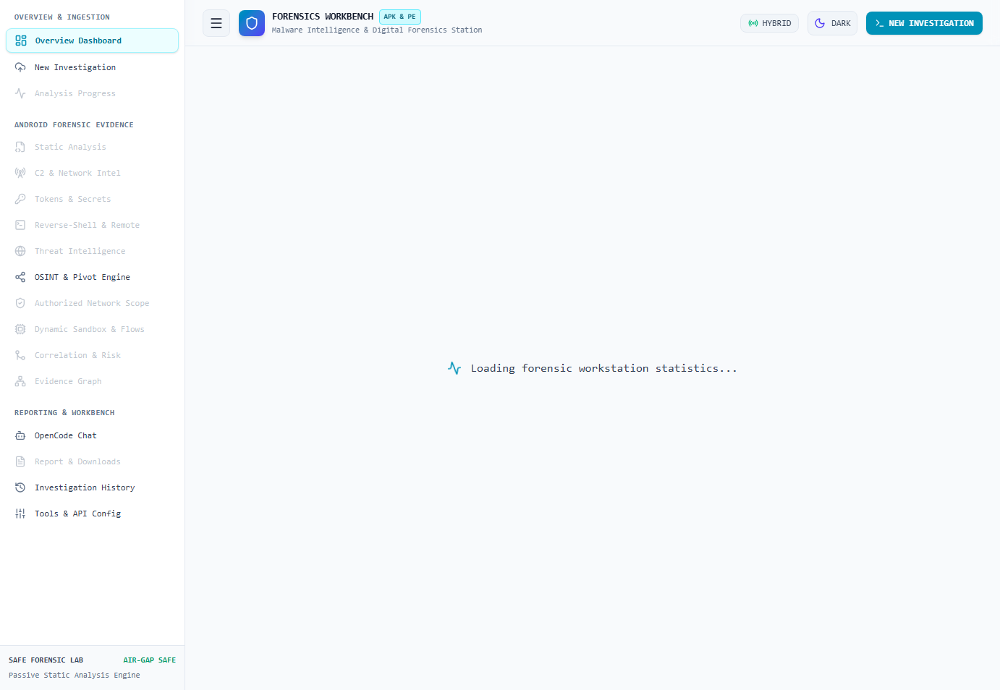
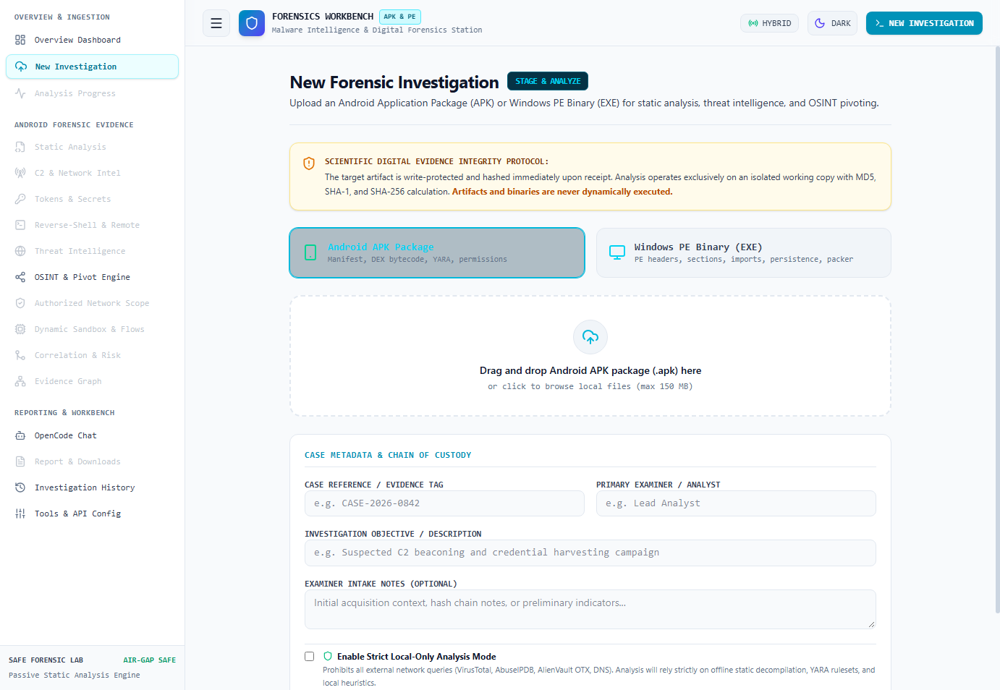
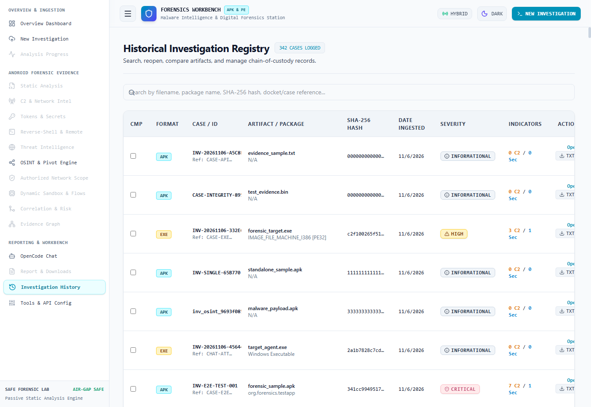
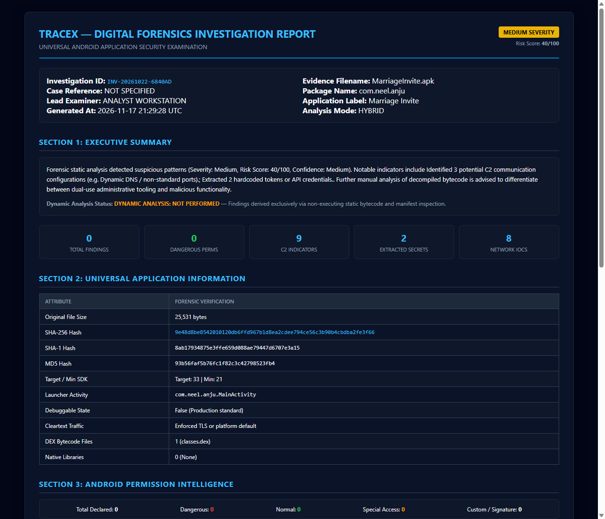
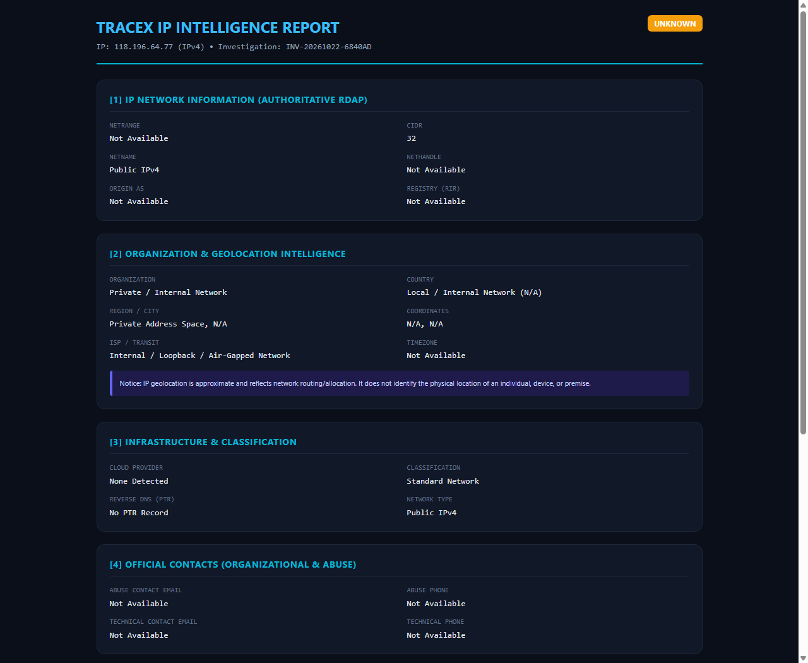
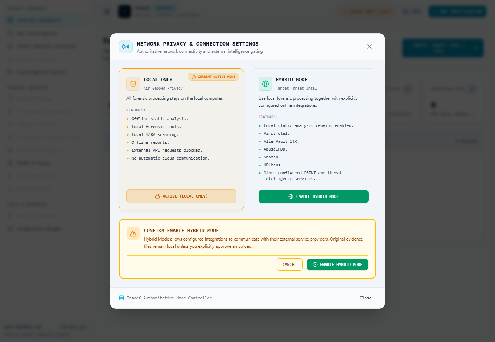
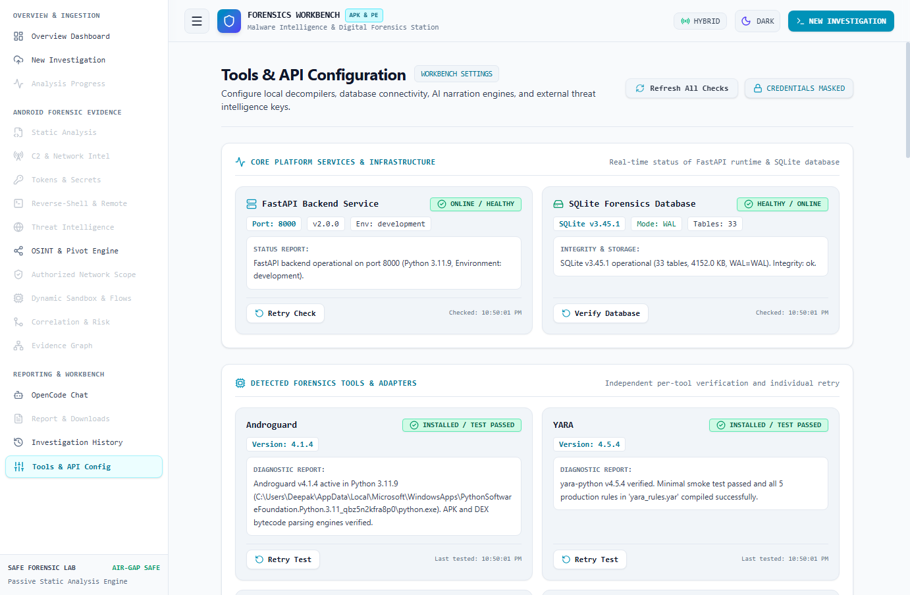
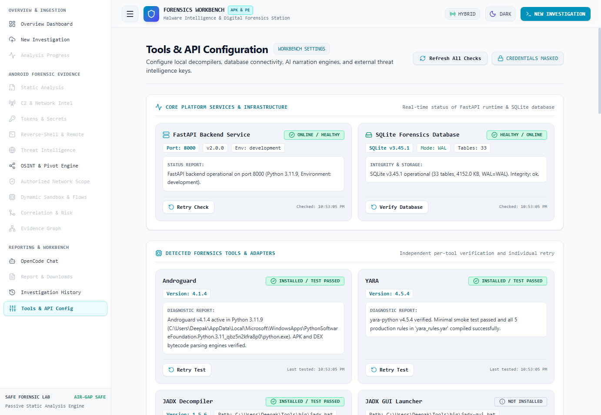

# TraceX – Digital Forensics & Cyber Investigation Suite

> **Discover. Analyze. Investigate.**

[](https://github.com/DeepakDubat/TraceX-Digital-Forensics)
[](https://www.python.org/)
[](https://fastapi.tiangolo.com/)
[](https://react.dev/)
[](https://www.typescriptlang.org/)
[](LICENSE)

TraceX is an enterprise-grade, local-first digital forensics, binary reverse engineering, and threat intelligence desktop platform. Built specifically for accredited cybersecurity laboratories, law-enforcement digital evidence units, incident responders, and forensic examiners, TraceX delivers universal static multi-artifact triage, deep binary inspection, and evidentiary report generation on Windows.

---

## Key Capabilities

* **Universal Evidence Ingestion ($200\text{ MB}$ Individual Limit):**  
  Ingest single artifacts or multi-file case directories up to $200\text{ MB}$ per file. The streaming engine hashes data in 64 KB buffers, preventing memory exhaustion.
* **Android Mobile Forensics (APK / DEX):**  
  Decompilation via integrated JADX and Apktool, `AndroidManifest.xml` inspection, dangerous permission profiling, entry-point activities, intent filters, hardcoded strings, and V1/V2/V3 signature verification.
* **Windows Portable Executable Analysis (EXE / DLL / SYS):**  
  Deep DOS/PE structural parsing (`pefile`), section table bounds checking, Shannon entropy per section, Authenticode signature inspection, import/export directory extraction, and injection triad detection.
* **Linux ELF & Binary Analysis:**  
  Header inspection, architecture verification, section mapping, dynamic symbols, and suspicious API call identification.
* **Document & Archive Forensics:**  
  * **PDFs:** Revision history, metadata, `/Launch`, `/JavaScript`, `/OpenAction` trigger detection, and embedded payload extraction.
  * **Office OpenXML (DOCX, XLSX, PPTX):** Macro / VBA inspection, hidden sheets, DDE formulas, and embedded OLE objects.
  * **Archives (ZIP, TAR, GZ, 7Z):** Zip-Slip path traversal protection and decompression bomb ratio analysis.
* **Network & Email Evidence:**  
  * **PCAP / PCAPNG:** Offline packet dissection via TShark, DNS queries, HTTP hostnames, TLS SNI, and flow telemetry.
  * **Email (EML / MSG):** Transport header analysis, SPF/DKIM/DMARC status, hop tracking, and attachment extraction.
* **IP Details & Threat Intelligence Dossiers:**  
  Dedicated IP intelligence module that extracts external IPs and hardcoded C2 servers from DEX, resources, and strings. Enriches findings with WHOIS/RDAP, ASN ownership, and geolocation. Exports dedicated multi-page intelligence dossiers.
* **Evidence Graph & Correlation Engine:**  
  Correlates artifacts across cases based on cryptographic hashes, shared C2 endpoints, parent-child process relationships, and perceptual image similarities (dHash/aHash).
* **Cryptographic Chain of Custody:**  
  Append-only SQLite custody ledger chaining events cryptographically:
  $$\text{event\_hash} = \text{SHA256}(\text{prev\_hash} + \text{timestamp} + \text{event\_type} + \text{details})$$
  Ensures ISO/IEC 27037 forensic reproducibility.
* **Multi-Format Forensic Reporting:**  
  Exports court-ready plain text reports (`.txt`), interactive HTML dossiers (`.html`), structured JSON, CSV IOCs, and executive PDF summaries.

---

## Application Screenshots

### 1. Overview Dashboard & Case Management

*Centralized forensic workstation dashboard tracking active dockets, risk scoring, evidence distributions, and tool diagnostics.*

---

### 2. Evidence Intake & Universal Ingestion

*Multi-format evidence staging supporting mobile APKs, Windows EXEs, ELFs, PDFs, archives, and PCAPs with instant hash generation and a $200\text{ MB}$ per-file ceiling.*

---

### 3. Investigation History & Chain of Custody

*Cryptographic evidence ledger tracking every investigation, examiner notes, original hashes, and verified working copies.*

---

### 4. Android APK Forensic Investigation Report

*Deep decompilation view displaying package manifests, dangerous permissions, code signatures, and certificate fingerprints.*

---

### 5. IP Details & Threat Intelligence Dossier

*Comprehensive IP intelligence workspace showing extracted C2 addresses, ASN ownership, RDAP records, and threat classification.*

---

### 6. Network Privacy Mode Selector

*Guaranteed privacy controls enabling examiners to toggle between strict offline air-gapped analysis (`LOCAL ONLY`) and passive threat intelligence lookup (`HYBRID`).*

---

### 7. Integrated Forensic Engines & Tool Diagnostics

*Real-time diagnostic health check verifying local binaries for JADX, Apktool, YARA, TShark, Suricata, and ExifTool.*

---

### 8. Interactive Report Viewer

*Integrated document viewer with secure path validation, native Windows Explorer highlighting, and atomic report compilation.*

---

## Technology Stack

| Layer | Component | Technologies |
| :--- | :--- | :--- |
| **Frontend UI** | Desktop Client Interface | React 19, TypeScript 5.6, Vite, Tailwind CSS v4, Lucide Icons |
| **Backend API** | High-Performance Server | FastAPI, Uvicorn (ASGI), Python 3.11, Pydantic v2 |
| **Desktop Host** | Desktop Shell & Native Window | Windows WebView2 / PyInstaller runtime host |
| **Database** | Evidence Ledger & Metadata | SQLite 3 with Write-Ahead Logging (`PRAGMA journal_mode=WAL`) |
| **Decompilers** | Bytecode & Resource Decoding | JADX v1.5.6, Apktool v3.0.3, OpenJDK 21 LTS |
| **Binary Parsers** | Binary & Metadata Analyzers | `pefile`, `androguard`, `yara-python`, `exiftool`, `tshark` |
| **Security** | Secret Protection & Hardening | Windows DPAPI (`CryptProtectData`), Centralized String Redaction |

---

## Integrated Tools & Dependencies

TraceX seamlessly coordinates both bundled and external forensic utilities:

| Tool | Version | Role in TraceX | Distribution Model |
| :--- | :--- | :--- | :--- |
| **JADX** | v1.5.6 | Dalvik DEX decompilation to Java source | Bundled in installer (`tools/jadx`) / System PATH in dev |
| **Apktool** | v3.0.3 | Binary XML and resource table unpacking | Bundled in installer (`tools/apktool`) / System PATH in dev |
| **YARA** | v4.5.1 | Malware rule matching & heuristic signatures | Bundled Python C-extensions (`yara-python`) |
| **TShark** | v4.6.9 | Offline PCAP/PCAPNG network packet dissection | Bundled in installer (`tools/tshark`) / System PATH in dev |
| **Suricata** | v8.0.8 | Offline network threat signature evaluation | Bundled in installer (`tools/suricata`) / Optional external |
| **ExifTool** | v13.64 | Metadata extraction from media and documents | Bundled in installer (`tools/exiftool`) / System PATH in dev |
| **OpenJDK** | 21.0.4 LTS | Stripped Java runtime (`jlink`) powering decompilers | Bundled in installer (`tools/java`) / System `JAVA_HOME` in dev |
| **OpenCode CLI** | Optional | Forensic observation assistant | External user-managed CLI (BYOK) |

*For complete tool integration specifications, see [docs/TOOLS.md](docs/TOOLS.md).*

---

## Architecture

TraceX operates as a local-first desktop application bound exclusively to loopback (`127.0.0.1`):

```
┌──────────────────────────────────────────────────────────────┐
│                    TraceX Desktop Application                │
│                                                              │
│  ┌──────────────────────┐         HTTP / WebSocket (Local)   │
│  │  React 19 Frontend   │ ◄──────────────────────────────►   │
│  │ (WebView2 Desktop UI)│                                    │
│  └──────────┬───────────┘                                    │
│             │                                                │
│  ┌──────────▼──────────────────────────────────────────────┐ │
│  │       FastAPI Backend Engine (Python 3.11 / Uvicorn)    │ │
│  └───────┬──────────────────────────┬──────────────────────┘ │
└──────────┼──────────────────────────┼────────────────────────┘
           │                          │
           ▼                          ▼
┌──────────────────────┐   ┌───────────────────────────────────┐
│ Isolated Workspaces  │   │ SQLite Ledger & Settings Store    │
│  original/ (0o444)   │   │  • Cryptographic Chain of Custody │
│  working/ (Analysis) │   │  • DPAPI-Encrypted API Secrets    │
└──────────────────────┘   └───────────────────────────────────┘
```

*For complete architecture specifications, see [docs/ARCHITECTURE.md](docs/ARCHITECTURE.md).*

---

## Installation & Development Setup

### 1. Prerequisites
* **Operating System:** Windows 10/11 x64
* **Python:** 3.11 x64 (`python --version` or `py -3.11 --version`)
* **Node.js:** v18+ or v20+ with `npm` (`node -v`)
* **Java:** OpenJDK 17 or 21 (for running JADX and Apktool)

### 2. Quick Setup

```powershell
# 1. Clone repository
git clone https://github.com/DeepakDubat/TraceX-Digital-Forensics.git
cd TraceX-Digital-Forensics

# 2. Configure environment template
copy .env.example .env

# 3. Install backend dependencies
py -3.11 -m venv .venv
.\.venv\Scripts\Activate.ps1
py -3.11 -m pip install -r backend/requirements.txt

# 4. Install frontend dependencies
cd frontend
npm.cmd install
cd ..

# 5. Launch development workstation
.\start_workbench.ps1
```
* **Frontend UI:** `http://127.0.0.1:5173`
* **FastAPI Backend:** `http://127.0.0.1:8000`
* **Interactive API Documentation:** `http://127.0.0.1:8000/docs`

*For complete setup instructions, see [docs/INSTALLATION.md](docs/INSTALLATION.md).*

---

## Verification & Automated Testing

TraceX maintains rigorous test suites covering boundary conditions, security containment, and forensic accuracy:

```powershell
# Run 200 MB upload limit & streaming boundary tests
py -3.11 -m pytest tests/test_upload_size_limit_200mb.py -v

# Run IP Details containment & network mode synchronization tests
py -3.11 -m pytest tests/test_ip_report_access_and_network_mode_sync.py -v

# Run full forensic extraction regression suite
py -3.11 -m pytest tests/test_marriage_invite_ip_details.py tests/test_ip_details_feature.py -v
```

---

## Security & Forensic Privacy Principles

1. **Zero-Execution Static Guarantee:**  
   TraceX never natively executes target binaries or scripts on the host workstation. All analysis is performed via static header parsing, structural inspection, and bytecode decompilation.
2. **Read-Only Evidence Preservation:**  
   Original artifacts are stored with read-only permissions (`0o444`). All analysis tools operate strictly on identical working copies.
3. **Local-First Privacy Modes:**
   * **LOCAL ONLY (Default):** Completely air-gapped. Prohibits all outbound network calls.
   * **HYBRID:** Allows passive reputation lookup of file hashes and IP addresses. Raw evidence files are never uploaded to any cloud service.
4. **Bring Your Own Key (BYOK):**  
   External API credentials are encrypted with Windows DPAPI and stored locally. Zero telemetry or credentials are transmitted to remote servers.

*For security vulnerability disclosure and handling procedures, see [SECURITY.md](SECURITY.md).*

---

## Known Limitations

* **Dynamic Sandboxing:** Full dynamic execution requires an isolated virtual machine environment (e.g., VirtualBox with guest agents) and is not executed directly on the host workstation.
* **Obfuscated & Packed Binaries:** Strongly packed or virtualized binaries (e.g., VMP, Themida, DexGuard) may require manual unpacking prior to static inspection.
* **Large Files:** Individual evidence files are capped at $200\text{ MB}$ per file to maintain workstation stability and deterministic memory consumption.

---

## License

This project is licensed under the [MIT License](LICENSE) - see the LICENSE file for details.
