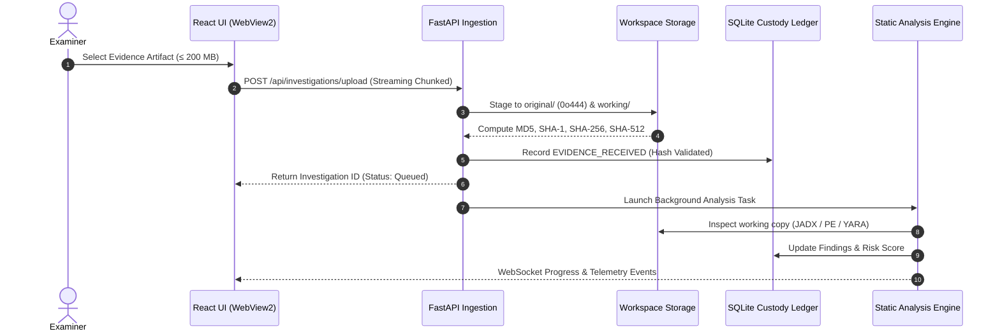

# TraceX Architectural Specification

TraceX is engineered as a modern, local-first Windows desktop forensics workstation designed for high-assurance evidence triage, reverse engineering, and threat intelligence.

---

## 1. System Overview

The application follows a decoupled multi-tier desktop architecture:

```
┌────────────────────────────────────────────────────────────────────────┐
│                        Windows Desktop Runtime                         │
│                                                                        │
│   ┌───────────────────────────┐      WebSocket / HTTP (127.0.0.1)      │
│   │   React 19 / TypeScript   │ ◄─────────────────────────────────►    │
│   │    Tailwind CSS v4 UI     │                                        │
│   └─────────────┬─────────────┘                                        │
│                 │ Embedded via WebView2 / Local Chromium Engine        │
│   ┌─────────────▼──────────────────────────────────────────────────┐   │
│   │                FastAPI Asynchronous Backend Engine             │   │
│   │            (Uvicorn loopback binding, Python 3.11)             │   │
│   └──────┬──────────────────────┬───────────────────────────┬──────┘   │
└──────────┼──────────────────────┼───────────────────────────┼──────────┘
           │                      │                           │
           ▼                      ▼                           ▼
┌────────────────────┐ ┌────────────────────┐ ┌───────────────────────────┐
│  Evidence Storage  │ │  SQLite Database   │ │ Integrated Forensic Tools │
│ (Isolated Workspace│ │  & Audit Ledger    │ │  • JADX / Apktool         │
│  Original/Working) │ │  (WAL Journaling)  │ │  • YARA / ExifTool        │
│                    │ │                    │ │  • TShark / Suricata      │
└────────────────────┘ └────────────────────┘ └───────────────────────────┘
```

---

## 2. Component Breakdown

### A. Frontend Layer
* **Framework:** React 19 with TypeScript, bundled using Vite.
* **Styling & Design System:** Tailwind CSS v4 featuring dual high-contrast desktop themes (Workstation Light and Obsidian Dark).
* **State Management:** React hooks and context-based state synchronization with real-time WebSocket feeds for long-running decompilation jobs.
* **Component Hierarchy:**
  * `Overview Dashboard`: High-level case metrics, recent investigations, tool health matrix.
  * `New Investigation`: Multi-format evidence staging with instant file hash validation and size bounds ($200\text{ MB}$).
  * `Static Workspace & Findings`: Tabulated permissions, components, string pool, DEX/PE headers, and decompiled code view.
  * `IP Details & Dossier`: Dedicated IP intelligence workspace extracting hardcoded endpoints and attributing ownership.
  * `Evidence Graph`: Visual graph view correlating artifacts, endpoints, and threat actors.
  * `Report Viewer`: Integrated document view with atomic export to PDF, HTML, and CSV.

### B. Backend Services Layer
* **API Framework:** FastAPI on Python 3.11 with asynchronous endpoint routing.
* **Network Binding:** Binds exclusively to loopback (`127.0.0.1` / `::1`). Remote network connections are rejected at the application middleware level.
* **Ingestion Pipeline:**
  * 64 KB chunked streaming upload (`safe_copy_upload`) enforcing an individual artifact ceiling of $200\text{ MB}$ ($209{,}715{,}200\text{ bytes}$).
  * Streaming cryptographic hash calculation (MD5, SHA-1, SHA-256, SHA-512).
  * Shannon entropy sampling ($5\text{ MB}$ maximum window).
  * Magic byte triage and structural validation before queueing.

### C. Forensic Workspaces & Evidence Storage
Every investigation receives an isolated filesystem directory:
```
analysis_workspace/
  └── <INVESTIGATION_ID>/
        ├── original/       # Untouched evidence artifact (marked read-only 0o444)
        ├── working/        # Identical mirror for static tools to inspect
        ├── extracted/      # Unpacked resources, DEX archives, PE sections
        ├── decompile/      # Smali and decompiled Java/C source code
        └── captures/       # Associated network PCAP/PCAPNG packet traces
```

### D. Database & Integrity Ledger
* **Engine:** SQLite with Write-Ahead Logging (`PRAGMA journal_mode=WAL`) and foreign key constraints enabled.
* **Cryptographic Chain of Custody:**
  * Every evidence touchpoint (`EVIDENCE_RECEIVED`, `DECOMPILATION_STARTED`, `ANALYSIS_COMPLETED`, `REPORT_EXPORTED`) is appended as an immutable record in the `chain_of_custody` ledger.
  * Each record stores the examiner identity, timestamp, original SHA-256, working copy SHA-256, and verification status.

---

## 3. Analysis Pipeline Workflow



---

## 4. Report Generation & System Access Security

* **Multi-Format Compilation:** Supports plain text forensic reports (`.txt`), self-contained HTML dossiers (`.html`), structured JSON, and formatted PDF summaries (`.pdf`).
* **Approved Directory Containment:**
  System report actions (`Open Report`, `Show in Folder`, `Copy Path`) are protected by multi-root path containment:
  * `%USERPROFILE%\Documents\TraceX\Reports\`
  * `%USERPROFILE%\Documents\TraceX\IP Reports\`
* Path resolution uses `pathlib.Path.resolve()` to ensure no path traversal (`../`), symlink redirections, or unauthorized system access can be triggered from the desktop client.
